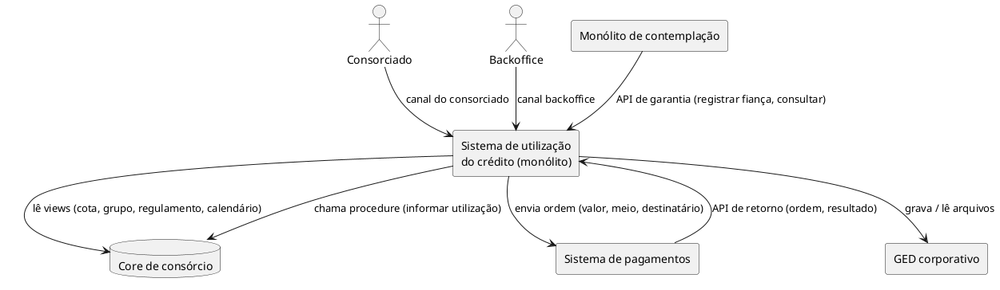
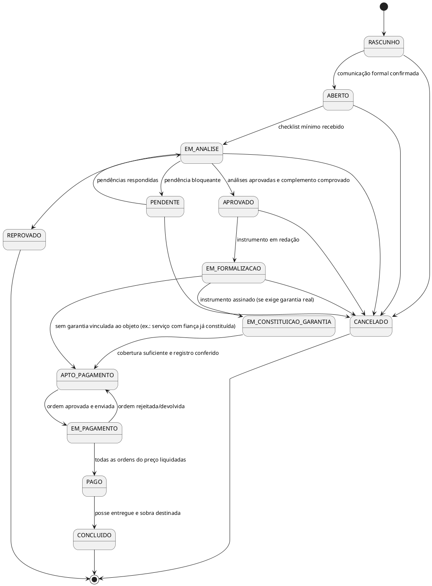

# Arquitetura e modelo de dados: utilização da carta de crédito

Desenho técnico da solução que implementa o [BDUF negocial](../bduf/README.md), começando pela [etapa 1 do roadmap](../roadmap/etapa-01-imovel-urbano/README.md) (imóvel urbano pronto) e já preparado para as demais modalidades (veículos, bens móveis, serviços, quitação de financiamento).

Este documento é **esquema**, não código: ele fixa módulos, fronteiras, entidades, tabelas, estados e integrações para que o time planeje e construa sem redesenhar a cada modalidade.

## Índice

1. [Intenção](#1-intenção)
2. [Objetivos, não objetivos e antiobjetivos](#2-objetivos-não-objetivos-e-antiobjetivos)
3. [Restrições e premissas](#3-restrições-e-premissas)
4. [Contexto e integrações](#4-contexto-e-integrações)
5. [Módulos do monólito](#5-módulos-do-monólito)
6. [Modelo de dados](#6-modelo-de-dados)
7. [Ciclos de vida](#7-ciclos-de-vida)
8. [Roteiros por modalidade](#8-roteiros-por-modalidade)
9. [Como encaixar uma nova modalidade](#9-como-encaixar-uma-nova-modalidade)
10. [Consistência e transações](#10-consistência-e-transações)
11. [Decisões: quem decidiu o quê](#11-decisões-quem-decidiu-o-quê)
12. [Em aberto](#12-em-aberto)

---

## 1. Intenção

Existe um sistema inicial (Java, Quarkus, Oracle) com as entidades **Processo → ProcessoImobiliario**, BemImovel, responsável pelo acompanhamento, Documento, Atendimento, Cota, RecursoFinanceiro, Pessoa vinculada ao processo, InstrumentoCredito, documento da pessoa e Pagamento.

O objetivo é transformar esse ponto de partida numa base única para **todas as modalidades** de utilização do crédito, de modo que uma modalidade nova seja **acrescentar** (uma especialização, um roteiro, tipos de documento) e não **reescrever**. O BDUF diz o que o negócio precisa; este documento diz onde cada coisa mora.

## 2. Objetivos, não objetivos e antiobjetivos

**Objetivos**
- Arquitetura de um monólito modular com fronteiras explícitas entre módulos.
- Modelo de dados Oracle que comporte N cotas e N bens por processo, composição de origens no pagamento e garantias com vida própria.
- Roteiro de fases por modalidade, declarado em código, sobre um catálogo comum.
- Integrações isoladas atrás de adaptadores (core, pagamentos, GED, contemplação).
- Guia de encaixe para auto, moto, eletro, serviço e quitação de financiamento.

**Não objetivos (por ora)**
- Escrever código ou migrations.
- Motor de workflow/BPMN em execução: os BPMN do repositório são referência, não runtime.
- Integração com cartório, prefeitura ou seguradora: na etapa 1 o backoffice registra manualmente.
- Ser fonte da verdade de cota, grupo, regulamento ou contabilidade (é o core).

**Antiobjetivos (o que tornaria o desenho um fracasso mesmo funcionando)**
- Transação distribuída entre sistemas.
- Uma modalidade nova exigir alteração em tabelas ou regras de outra modalidade.
- Uma cota usada em dois processos ativos ao mesmo tempo.
- Pagamento enviado sem registro no sistema, ou registrado e nunca enviado, sem que ninguém perceba.
- Pagamento liberado sem a garantia exigida constituída.

## 3. Restrições e premissas

| # | Restrição / premissa | Origem |
|---|---|---|
| R1 | Java + Quarkus + Oracle | Usuário |
| R2 | **Uma aplicação** (monólito); volume máximo ~800 processos/dia | Usuário |
| R3 | Evitar transação distribuída sempre que possível | Usuário |
| R4 | Processo especializado por **JOINED** | Usuário (já existe) |
| R5 | Cota, grupo, regime normativo, regulamento, parâmetros e calendário vêm do **core**: só consulta | Usuário |
| R6 | Leitura do core por **acesso direto ao banco**; escrita no core por **procedure** | Usuário |
| R7 | Pagamento executado por **sistema externo**: recebe valor, meio (TED, Pix…) e destinatário; devolve o resultado chamando uma **API nossa** | Usuário |
| R8 | Arquivos de documentos ficam no **GED corporativo**; aqui só metadados | Usuário |
| R9 | Usuários: **consorciado** (externo) e **backoffice** (interno) | Usuário |
| R10 | Contemplação é **outro monólito**; nele o fiador é declarado formalmente | Usuário |
| R11 | Roteiros mudam pelo **time de desenvolvimento**, com deploy | Usuário |
| P1 | Hibernate ORM (JPA/Panache) como camada de persistência | Minha suposição |
| P2 | Oracle 19c ou superior (identity columns, índices baseados em função) | Minha suposição |

## 4. Contexto e integrações



| Integração | Direção | Mecanismo | Padrão no nosso lado |
|---|---|---|---|
| Core: consultas | lê | Views no banco do core (combinar com o time do core um conjunto de **views estáveis** em vez de tabelas internas) | Porta `ConsultaCore`, adaptador JDBC/JPA somente leitura, datasource próprio |
| Core: informar utilização | escreve | Procedure | Porta `InformaCore`, chamada a partir da **outbox** (seção 10) |
| Pagamentos: ordem | escreve | Chamada ao sistema externo | Porta `EnviaOrdemPagamento`, via outbox, com chave de idempotência = id da ordem |
| Pagamentos: retorno | recebe | API REST nossa | Endpoint idempotente; identifica a **ordem**, não só o processo |
| GED | lê/escreve | API do GED | Porta `RepositorioArquivos`; guardamos `id_ged`, hash, tipo MIME |
| Contemplação | recebe | API REST nossa (módulo Garantia) | Chave de idempotência do chamador; contemplação usa outbox do lado dela |
| Cartório, prefeitura, seguradora | — | Manual na etapa 1 | Telas do backoffice registram protocolo, prenotação, registro, apólice, guia de ITBI |

**Retorno de pagamento.** Hoje o externo informa o processo. Recomendo que passe a informar o **identificador da ordem** (enviado por nós na ordem), porque um processo gera várias ordens (vendedor, ressarcimento de sinal, despesas, sobra). Enquanto isso não muda, o retorno só é aceito se o processo tiver exatamente uma ordem `ENVIADA` daquele valor e beneficiário; senão, vai para tratamento manual.

## 5. Módulos do monólito

Uma aplicação Quarkus, um deploy, um banco. Dentro dela, módulos com fronteira explícita (pacotes raiz ou módulos Maven; a forma fica com o time, a regra de dependência não).

```
canal-backoffice   canal-consorciado        (REST + autorização por perfil / por titular)
        \               /
         v             v
   +---------------------------------------------------------------+
   | processo        núcleo + modalidades + roteiros + análises +  |
   |                 pendências + objetos (bens/serviços)          |
   | participacao    pessoas e papéis no processo                  |
   | documento       metadados, checklist, conferência             |
   | cota            vínculo cota-processo, reserva, snapshots      |
   | instrumento     contratos genéricos e signatários             |
   | pagamento       ordens, composição de origens, retornos       |
   | garantia        garantias da cota (fiança, AF, ...)  [isolado] |
   | atendimento     interações com o cliente                      |
   +---------------------------------------------------------------+
         |                         |
   integracao (adaptadores: core, pagamentos, GED)     outbox / inbox
```

**Regras de dependência**
1. Módulos conversam por **interfaces de serviço** do módulo, nunca acessando o repositório ou a entidade JPA de outro módulo.
2. Dentro da "família processo" (processo, participacao, documento, cota, instrumento, pagamento, atendimento) chaves estrangeiras no banco são permitidas: é o mesmo agregado de negócio e extrair não é previsto.
3. **Garantia é isolada**: nenhuma FK entre tabelas `GAR_*` e as demais; referências são por identificador (id da cota no core, id do bem, id do instrumento). Ela é a única candidata real a virar serviço próprio e assim continua extraível.
4. Domínio não conhece JDBC do core, HTTP do pagamento nem API do GED: só portas.
5. Testes de arquitetura (ex.: ArchUnit) garantem 1 a 4 no build.

**Por que garantia é módulo aqui e não sistema separado.** O acoplamento forte é com o pagamento: "só paga com garantia constituída" é verificado no mesmo instante em que o pagamento fica apto, e a AF nasce do instrumento e do bem que moram aqui. Separar criaria a transação distribuída que R3 proíbe. A contemplação precisa de pouco (registrar fiança, consultar cobertura) e tolera chamada síncrona.

**Canais.** Mesmo domínio, duas superfícies:
- *Backoffice:* tudo, filtrado por perfil (Atendimento, Crédito/PLD, Formalização/Jurídico/Engenharia, Tesouraria) e com segregação de funções (quem prepara a ordem não aprova).
- *Consorciado:* só processos em que é titular; ações limitadas a abrir processo, enviar documentos, confirmar comunicação formal, escolher destinação da sobra, acompanhar.

## 6. Modelo de dados

### 6.1 Visão geral

```plantuml
@startuml modelo
hide circle
skinparam linetype ortho

package processo {
  entity PRC_PROCESSO {
    *id
    tipo_processo (discriminador)
    categoria
    finalidade
    estado
    versao
  }
  entity PRC_PROCESSO_IMOBILIARIO
  entity PRC_PROCESSO_VEICULO
  entity PRC_PROCESSO_BEM_MOVEL
  entity PRC_PROCESSO_SERVICO
  entity PRC_OBJETO {
    *id
    processo_id
    tipo_objeto
    valor_negociado
    valor_avaliado
  }
  entity PRC_OBJETO_IMOVEL
  entity PRC_OBJETO_VEICULO
  entity PRC_OBJETO_BEM_MOVEL
  entity PRC_OBJETO_SERVICO
  entity PRC_CONTATO_ACESSO
  entity PRC_ETAPA
  entity PRC_ANALISE
  entity PRC_PENDENCIA
  entity PRC_HISTORICO
  entity PRC_RECURSO
  entity PRC_SOBRA_DESTINACAO
}
package participacao {
  entity PES_PESSOA
  entity PES_PARTICIPACAO
  entity PES_CONTA_RECEBIMENTO
}
package cota { entity COT_PROCESSO_COTA }
package documento { entity DOC_DOCUMENTO }
package instrumento {
  entity INS_INSTRUMENTO
  entity INS_SIGNATARIO
}
package pagamento {
  entity PAG_ORDEM
  entity PAG_ORDEM_ORIGEM
  entity PAG_RETORNO
}
package atendimento { entity ATD_ATENDIMENTO }
package garantia {
  entity GAR_GARANTIA
  entity GAR_FIADOR
  entity GAR_REGISTRO
  entity GAR_EVENTO
}

PRC_PROCESSO <|-- PRC_PROCESSO_IMOBILIARIO
PRC_PROCESSO <|-- PRC_PROCESSO_VEICULO
PRC_PROCESSO <|-- PRC_PROCESSO_BEM_MOVEL
PRC_PROCESSO <|-- PRC_PROCESSO_SERVICO
PRC_OBJETO <|-- PRC_OBJETO_IMOVEL
PRC_OBJETO <|-- PRC_OBJETO_VEICULO
PRC_OBJETO <|-- PRC_OBJETO_BEM_MOVEL
PRC_OBJETO <|-- PRC_OBJETO_SERVICO

PRC_PROCESSO ||--|{ PRC_OBJETO
PRC_OBJETO ||--o{ PRC_CONTATO_ACESSO
PRC_PROCESSO ||--|{ PRC_ETAPA
PRC_PROCESSO ||--o{ PRC_ANALISE
PRC_PROCESSO ||--o{ PRC_PENDENCIA
PRC_PROCESSO ||--o{ PRC_HISTORICO
PRC_PROCESSO ||--o{ PRC_RECURSO
PRC_PROCESSO ||--|{ COT_PROCESSO_COTA
PRC_PROCESSO ||--|{ PES_PARTICIPACAO
PES_PESSOA ||--o{ PES_PARTICIPACAO
PES_PARTICIPACAO ||--o{ PES_CONTA_RECEBIMENTO
PRC_PROCESSO ||--o{ INS_INSTRUMENTO
INS_INSTRUMENTO ||--|{ INS_SIGNATARIO
PES_PARTICIPACAO ||--o{ INS_SIGNATARIO
PRC_PROCESSO ||--o{ PAG_ORDEM
PES_PARTICIPACAO ||--o{ PAG_ORDEM : beneficiário
PAG_ORDEM ||--|{ PAG_ORDEM_ORIGEM
COT_PROCESSO_COTA ||--o{ PAG_ORDEM_ORIGEM
PRC_RECURSO ||--o{ PAG_ORDEM_ORIGEM
PAG_ORDEM ||--o{ PAG_RETORNO
PRC_PROCESSO ||--o{ ATD_ATENDIMENTO
PRC_PROCESSO ||--o{ PRC_SOBRA_DESTINACAO
GAR_GARANTIA ||--o{ GAR_FIADOR
GAR_GARANTIA ||--o{ GAR_REGISTRO
GAR_GARANTIA ||--o{ GAR_EVENTO
@enduml
```

Garantia aparece sem linhas para as demais de propósito: ela referencia cota, objeto e instrumento **por id**, sem FK (regra 3 da seção 5).

### 6.2 Do modelo atual para o proposto

| Entidade atual | Proposta | Mudança |
|---|---|---|
| Processo → ProcessoImobiliario (JOINED) | `PRC_PROCESSO` → `PRC_PROCESSO_<MODALIDADE>` | Mantém. Acrescenta `categoria`, `finalidade`, `estado`, `versao` (lock otimista) na raiz |
| BemImovel | `PRC_OBJETO` → `PRC_OBJETO_IMOVEL` | Generaliza a raiz para **Objeto** (bem ou serviço), também JOINED. Serviço não é bem, por isso o nome. *Minha decisão; se preferir manter "Bem", a estrutura é a mesma* |
| Responsável pelo acompanhamento (no bem) | `PRC_CONTATO_ACESSO` (no objeto) | Renomeia: é quem dá acesso ao vistoriador; não é papel jurídico |
| Documento (no imóvel) e documento da pessoa | `DOC_DOCUMENTO` único, com dono exclusivo | Une as duas tabelas; o dono é objeto, participação, processo ou instrumento (ver 6.4) |
| Atendimento | `ATD_ATENDIMENTO` | Mantém |
| Cotas do processo | `COT_PROCESSO_COTA` | Vira entidade de vínculo com situação, valores e snapshot do core |
| Recurso financeiro (entrada, FGTS) | `PRC_RECURSO` | Mantém; ganha comprovante e forma de liquidação |
| Pessoa vinculada ao processo | `PES_PESSOA` + `PES_PARTICIPACAO` | Separa cadastro (único por CPF/CNPJ) de papel no processo |
| Instrumento de crédito | `INS_INSTRUMENTO` | Mantém genérico, com `tipo_instrumento`; ganha signatários e situação |
| Pagamento (na pessoa) | `PAG_ORDEM` + `PAG_ORDEM_ORIGEM` + `PAG_RETORNO` | Ordem com beneficiário = participação; origens somam o valor |
| — | `PRC_ETAPA`, `PRC_ANALISE`, `PRC_PENDENCIA`, `PRC_HISTORICO`, `PRC_SOBRA_DESTINACAO` | **Novas**, exigidas pelo BDUF |
| — | `GAR_*` | **Novo módulo** |
| — | `INT_OUTBOX`, `INT_INBOX` | **Novas**, técnicas (seção 10) |

### 6.3 Tabelas

Convenção: prefixo por módulo; `id NUMBER GENERATED AS IDENTITY`; auditoria em todas (`criado_em`, `criado_por`, `alterado_em`, `alterado_por`); enums como `VARCHAR2` com `CHECK`; valores monetários `NUMBER(15,2)`; nenhum dado do core copiado como verdade, apenas **snapshot** datado quando a regra precisa provar o que foi visto.

#### Processo

**PRC_PROCESSO** (raiz)

| Coluna | Observação |
|---|---|
| `id` | PK |
| `tipo_processo` | Discriminador JOINED: `IMOBILIARIO`, `VEICULO`, `BEM_MOVEL`, `SERVICO` |
| `categoria` | `IMOVEL`, `MOVEL_I`, `MOVEL_II`, `SERVICO`. Toda cota e todo objeto do processo devem ser desta categoria |
| `finalidade` | `AQUISICAO`, `QUITACAO_FINANCIAMENTO`, `CONSTRUCAO`, `REFORMA`, … (ortogonal ao tipo; ver seção 8) |
| `estado` | Estado macro (7.1) |
| `roteiro_codigo`, `roteiro_versao` | Qual roteiro e versão regem este processo (8.1) |
| `titular_pessoa_id` | FK `PES_PESSOA`; base da autorização do canal do consorciado |
| `canal_abertura` | `CONSORCIADO`, `BACKOFFICE` |
| `comunicacao_formal_em` | Data/hora da comunicação formal (art. 18 §2º I); inicia o prazo de análise |
| `prazo_analise_ate` | Calculado com o prazo do regulamento e o calendário do core |
| `regulamento_ref`, `regime_normativo` | Snapshot na abertura (`RES_285`/`CIRC_3432`) para provar a regra aplicada |
| `versao` | Lock otimista |

**PRC_PROCESSO_IMOBILIARIO / _VEICULO / _BEM_MOVEL / _SERVICO**: PK = FK para `PRC_PROCESSO.id`. Guardam apenas o que é do **processo** naquela modalidade e não do objeto. Na etapa 1 o imobiliário é fino (ex.: `tipo_operacao`: pronto, planta, terreno, construção, reforma; `municipio_itbi`). Se uma subclasse ficar vazia, mantenha-a mesmo assim: ela é o ponto de encaixe do roteiro e das regras da modalidade.

**PRC_OBJETO** (raiz, JOINED): `id`, `processo_id`, `tipo_objeto`, `descricao`, `valor_negociado`, `valor_avaliado`, `metodo_avaliacao`, `em_producao` (S/N), `fornecedor_participacao_id` (FK para quem vende/presta).

| Subtabela | Colunas específicas |
|---|---|
| `PRC_OBJETO_IMOVEL` | `matricula`, `cartorio_ri`, `inscricao_iptu`, endereço (UF, município, CEP, logradouro…), `tipo_imovel` (pronto, planta, terreno, empreendimento), `uso` (residencial, comercial), `construcao_averbada` (S/N) |
| `PRC_OBJETO_VEICULO` | `subtipo` (auto, moto, caminhão, máquina…), `novo_usado`, `chassi`, `renavam`, `placa`, `ano_fabricacao`, `ano_modelo`, `valor_referencia` (ex.: FIPE) e data |
| `PRC_OBJETO_BEM_MOVEL` | `descricao_fiscal`, `numero_nota_fiscal`, `chave_nfe`; sempre novo (subcategoria II) |
| `PRC_OBJETO_SERVICO` | `escopo`, `prazo_execucao`, `possui_cronograma` |

**PRC_CONTATO_ACESSO**: `objeto_id`, `nome`, `email`, `telefone`. Dado pessoal de terceiro: guardar só enquanto o processo estiver aberto (LGPD; ver 12).

**PRC_ETAPA**: uma linha por fase do roteiro, criada na abertura. `processo_id`, `codigo_fase` (ex.: `QUALIFICACAO_VENDEDOR`), `ordem`, `situacao` (`NAO_INICIADA`, `EM_ANDAMENTO`, `CONCLUIDA`, `DISPENSADA`, `BLOQUEADA`), `responsavel_perfil`, `iniciada_em`, `concluida_em`, `concluida_por`. Permite fases em paralelo sem estados combinados.

**PRC_ANALISE**: `processo_id`, `etapa_id`, `tipo` (`CAPACIDADE`, `PLD_VENDEDOR`, `JURIDICA`, `VISTORIA`, `CONSOLIDADA`), `resultado` (`APROVADO`, `APROVADO_COM_CONDICAO`, `PENDENTE`, `REPROVADO`), `fundamentacao`, `decidido_por`, `decidido_em`, `excecao_concedida` + `alcada`, `guardar_ate` (capacidade: 5 anos após o encerramento do grupo; data vem do core quando houver). Evidências são `DOC_DOCUMENTO` com dono = análise (ver 6.4).

**PRC_PENDENCIA**: `processo_id`, `etapa_id`, `motivo_codigo` (`MOT-xxx` do BDUF), `descricao`, `destinatario` (consorciado, vendedor, interno), `alvo_tipo` + `alvo_id` (documento, objeto, participação), `prazo_ate`, `situacao` (`ABERTA`, `RESPONDIDA`, `RESOLVIDA`, `CANCELADA`). Exigência de cartório também é pendência (`motivo_codigo` próprio).

**PRC_HISTORICO**: append-only. `processo_id`, `entidade` (processo, etapa, ordem…), `entidade_id`, `de`, `para`, `motivo`, `ator`, `em`. Toda transição de estado grava aqui na mesma transação.

**PRC_RECURSO**: `processo_id`, `tipo` (`RECURSOS_PROPRIOS`, `FGTS`, `SINAL`), `valor`, `liquidacao` (`DIRETO_AO_VENDEDOR`, `VIA_ADMINISTRADORA`), `comprovante_documento_id`, `situacao` (`DECLARADO`, `COMPROVADO`, `CANCELADO`).

**PRC_SOBRA_DESTINACAO**: `processo_id`, `processo_cota_id`, `tipo` (`DESPESA_VINCULADA`, `ABATER_PRESTACOES`, `DEVOLUCAO_COM_QUITACAO`), `valor`, `escolhido_por`, `escolhido_em`, `ordem_id` quando gera pagamento. Regra: soma de `DESPESA_VINCULADA` ≤ 10% do crédito da cota.

#### Participação

**PES_PESSOA**: `id`, `tipo` (PF/PJ), `cpf_cnpj` (único), `nome`, contatos. Cadastro mínimo; se houver cadastro corporativo, guardar `id_externo`.

**PES_PARTICIPACAO**: `processo_id`, `pessoa_id`, `papel` (`COMPRADOR`, `CONJUGE_COMPRADOR`, `VENDEDOR`, `CONJUGE_VENDEDOR`, `INTERVENIENTE_QUITANTE`, `CREDOR_FINANCIAMENTO`, `PRESTADOR`, `PROCURADOR`, `TESTEMUNHA`…), `estado_civil`, `regime_bens`, `qualificacao_resultado`, `qualificacao_validade`, `nivel_risco`. Único por (`processo_id`, `pessoa_id`, `papel`).

**PES_CONTA_RECEBIMENTO**: `participacao_id`, banco/agência/conta ou chave Pix, `titularidade_verificada` (S/N), `verificada_em`. A ordem de pagamento só aceita conta verificada.

#### Cota

**COT_PROCESSO_COTA**: o vínculo com vida própria.

| Coluna | Observação |
|---|---|
| `processo_id` | FK |
| `cota_ref` | Identificador da cota no core (grupo + cota) |
| `situacao` | `RESERVADA`, `UTILIZADA`, `LIBERADA` (7.3) |
| `valor_reservado` | Quanto desta cota o processo pretende usar |
| `valor_utilizado` | Soma das origens liquidadas |
| `snapshot_saldo`, `snapshot_em` | Saldo utilizável lido do core na reserva e de novo antes de cada ordem |
| `categoria_cota` | Lida do core; deve ser igual a `PRC_PROCESSO.categoria` |
| `data_contemplacao`, `lance_embutido` | Snapshot para cálculos (180 dias, teto da sobra) |

**Uma cota em um só processo ativo**: índice único baseado em função no Oracle:

```sql
CREATE UNIQUE INDEX ux_cot_cota_ativa
  ON cot_processo_cota (CASE WHEN situacao = 'RESERVADA' THEN cota_ref END);
```

O banco recusa a segunda reserva mesmo com duas requisições simultâneas; o serviço traduz a violação em "cota já está em uso no processo X".

#### Documento

**DOC_DOCUMENTO**: `tipo_documento` (catálogo por modalidade), `id_ged`, `nome_arquivo`, `mime`, `hash`, `emitido_em`, `valido_ate`, `situacao` (`ENVIADO`, `EM_CONFERENCIA`, `ACEITO`, `RECUSADO`, `VENCIDO`), `conferido_por`, `motivo_recusa`, e **dono exclusivo** (6.4).

**DOC_TIPO_EXIGIDO** (opcional, se o checklist for dado e não código): por `roteiro_codigo` + `papel`/`tipo_objeto` → `tipo_documento`, obrigatoriedade, validade máxima. Como os roteiros ficam em código (R11), o checklist pode ficar em código também; a tabela só vale se o Jurídico quiser ajustar sem deploy.

#### Instrumento

**INS_INSTRUMENTO**: `processo_id`, `tipo_instrumento` (`COMPRA_VENDA_COM_AF`, `CONTRATO_FINANCIAMENTO_A_QUITAR`, `TERMO_QUITACAO`, `CONTRATO_PRESTACAO_SERVICO`, `CONTRATO_OBRA`, …), `modelo_versao`, `situacao` (7.5), `documento_minuta_id`, `documento_assinado_id`, `forma_assinatura` (física, eletrônica).

**INS_SIGNATARIO**: `instrumento_id`, `participacao_id` (ou `representante_administradora`), `assinou_em`.

#### Pagamento

**PAG_ORDEM**

| Coluna | Observação |
|---|---|
| `processo_id` | FK |
| `beneficiario_participacao_id` | FK `PES_PARTICIPACAO` (vendedor, consorciado no ressarcimento do sinal, credor na quitação…) |
| `conta_recebimento_id` | FK, conta verificada |
| `finalidade_ordem` | `PRECO_OBJETO`, `RESSARCIMENTO_SINAL`, `DESPESA_VINCULADA`, `SOBRA`, `QUITACAO_FINANCIAMENTO`, `PARCELA_CRONOGRAMA` |
| `meio` | `TED`, `PIX`, … |
| `valor` | = soma de `PAG_ORDEM_ORIGEM.valor` (verificado no serviço e em gatilho/consulta de conciliação) |
| `situacao` | 7.4 |
| `preparada_por`, `aprovada_por` | Devem ser pessoas diferentes; aprovação respeita alçada |
| `parcela_numero` | Para pagamento em etapas (modalidades futuras) |
| `id_externo` | Retornado pelo sistema de pagamentos |

**PAG_ORDEM_ORIGEM**: `ordem_id`, `processo_cota_id` **ou** `recurso_id` (exatamente um; `CHECK`), `valor`. É a resposta a "de onde veio cada real".

**PAG_RETORNO**: `ordem_id` (ou nulo se não identificado), `chave_idempotencia` (única), `resultado` (`LIQUIDADO`, `REJEITADO`, `DEVOLVIDO`), `recebido_em`, `payload_bruto`.

#### Atendimento

**ATD_ATENDIMENTO**: mantém o que existe; acrescentar `pendencia_id` quando o atendimento responder a uma pendência.

#### Garantia (módulo isolado)

**GAR_GARANTIA**

| Coluna | Observação |
|---|---|
| `cota_ref` | Âncora: a garantia é da cota |
| `tipo` | `FIANCA`, `AF_IMOVEL`, `AF_VEICULO`, `AF_BEM_MOVEL`, `HIPOTECA`, `CARTA_FIANCA`, `AF_OUTRO_IMOVEL`, … |
| `origem` | `CONTEMPLACAO`, `PROCESSO_UTILIZACAO`, `SUBSTITUICAO` |
| `processo_ref`, `objeto_ref`, `instrumento_ref` | Ids, sem FK |
| `valor_cobertura` | Valor que a garantia cobre (ex.: valor avaliado) |
| `situacao` | 7.6 |
| `substitui_garantia_id` | FK interna ao módulo |
| `chave_idempotencia` | Única por chamador |

**GAR_FIADOR**: `garantia_id`, CPF/CNPJ, nome, vínculo, `analise_ref`. Fica aqui e não em `PES_*`, para o módulo continuar extraível.

**GAR_REGISTRO**: `garantia_id`, `orgao` (cartório RI, Detran/SNG, RTD), `protocolo`, `prenotacao_em`, `prenotacao_vence_em`, `numero_registro`, `registrado_em`, `documento_ref`.

**GAR_EVENTO**: append-only (`CRIADA`, `PROTOCOLADA`, `EXIGENCIA`, `REGISTRADA`, `CONFERIDA`, `SUBSTITUICAO_INICIADA`, `BAIXA_SOLICITADA`, `BAIXADA`, `EXECUCAO_INICIADA`…).

**API do módulo** (usada pelo processo e pela contemplação):

| Operação | Quem chama |
|---|---|
| `registrarFianca(cota, fiador, documentos, chave)` | Contemplação |
| `proporAlienacao(cota, objeto, instrumento, valorCobertura)` | Processo (na redação do instrumento) |
| `registrarProtocolo / registrarExigencia / registrarRegistro` | Backoffice (via processo) |
| `conferirRegistro(garantia, conferente)` | Backoffice (fase de conferência) |
| `cobertura(cota) → {exigido, constituído, suficiente: S/N, faltas}` | Processo (antes de liberar pagamento) e contemplação |
| `solicitarBaixa(cota)` / `iniciarExecucao(cota)` | Gatilho a partir de eventos do core (cota quitada; atraso > 1 prestação) |
| `substituir(garantiaAntiga, nova)` | Processo (planta → pronto, troca de garantia) |

### 6.4 Documento com dono exclusivo

Um documento pertence a exatamente um dono. Recomendo **colunas de FK anuláveis + CHECK** em vez de `dono_tipo`/`dono_id` genérico, porque mantém integridade referencial no Oracle:

```sql
-- objeto_id, participacao_id, processo_id, instrumento_id, analise_id: todas NULL exceto uma
CONSTRAINT ck_doc_dono_unico CHECK (
  NVL2(objeto_id,1,0) + NVL2(participacao_id,1,0) + NVL2(processo_id,1,0)
  + NVL2(instrumento_id,1,0) + NVL2(analise_id,1,0) = 1)
```

Documentos de garantia ficam com `documento_ref` no módulo de garantia (id, sem FK).

## 7. Ciclos de vida

### 7.1 Processo (estado macro, comum a todas as modalidades)



- O estado macro avança quando as **etapas-portão** do roteiro concluem; as etapas em si ficam em `PRC_ETAPA` e podem correr em paralelo.
- Cancelar libera as cotas (`RESERVADA → LIBERADA`) e cancela garantias ainda em constituição. Depois de `EM_CONSTITUICAO_GARANTIA` com registro feito, cancelar exige tratamento jurídico (fora do fluxo automático).
- `EM_PAGAMENTO` em pagamento por etapas: `PAGO` só quando a última parcela do cronograma liquidar.

### 7.2 Etapa

`NAO_INICIADA → EM_ANDAMENTO → CONCLUIDA`; `→ BLOQUEADA` quando a pré-condição deixa de valer (ex.: documento venceu); `→ DISPENSADA` quando a regra do roteiro dispensa (ex.: sem complemento, a fase de complemento é dispensada).

### 7.3 Vínculo cota-processo

```
RESERVADA --(processo PAGO)--> UTILIZADA      (saldo que sobrar fica livre no core para outro processo)
RESERVADA --(processo CANCELADO/REPROVADO)--> LIBERADA
```

Só `RESERVADA` conta como ativo (índice da 6.3).

### 7.4 Ordem de pagamento

```
PREPARADA → APROVADA → ENVIADA → LIQUIDADA
    ↓           ↓          ↓
CANCELADA   CANCELADA   REJEITADA | DEVOLVIDA  → (nova ordem, nunca reabrir a antiga)
```

`ENVIADA` só depois de a outbox confirmar o envio; `LIQUIDADA` só por retorno do sistema de pagamentos. Na liquidação, na mesma transação: atualiza `valor_utilizado` das cotas de origem, grava histórico e enfileira na outbox o "informar utilização" ao core.

### 7.5 Instrumento

`MINUTA → APROVADA → EM_ASSINATURA → ASSINADO → REGISTRADO` (quando o registro em órgão faz parte) ou `→ CANCELADO`.

### 7.6 Garantia

```
PROPOSTA → EM_CONSTITUICAO → CONSTITUIDA → (EM_SUBSTITUICAO) → BAIXADA
                 ↓                ↓
             CANCELADA      EM_EXECUCAO → EXECUTADA
```

Fiança declarada na contemplação nasce `CONSTITUIDA`. AF fica `EM_CONSTITUICAO` do protocolo até a conferência do registro.

## 8. Roteiros por modalidade

### 8.1 Mecânica

- Um **catálogo de fases** comum (enum/código): `CREDITO_DISPONIVEL`, `ABERTURA`, `DOCUMENTOS`, `QUALIFICACAO_BENEFICIARIO`, `CAPACIDADE`, `ANALISE_JURIDICA`, `VISTORIA_AVALIACAO`, `DECISAO_COMPLEMENTO`, `SEGUROS`, `REDACAO_INSTRUMENTO`, `ASSINATURAS`, `TRIBUTO_TRANSMISSAO`, `CONSTITUICAO_GARANTIA`, `CONFERENCIA_GARANTIA`, `LIBERACAO_PAGAMENTO`, `ENTREGA`, `SOBRA_ENCERRAMENTO`, `MEDICAO` (etapas), `QUITACAO_CONFIRMADA` (financiamento).
- Cada **roteiro** é uma classe (estratégia) escolhida por (`tipo_processo`, `finalidade`), que declara: fases e ordem; dependências (quais fases precisam estar concluídas para iniciar outra); quais fases são **portões** do estado macro; checklist de documentos por papel e por objeto; regras de pagamento (à vista, por etapas; pagar antes ou depois do registro).
- O roteiro tem **código e versão**, gravados no processo na abertura. Processos abertos continuam no roteiro com que nasceram; a versão nova vale para os próximos.
- Testes unitários por roteiro cobrem as dependências; os critérios de aceite do BDUF viram testes de aceitação.

### 8.2 Etapa 1: imóvel urbano pronto (`IMOBILIARIO` + `AQUISICAO`)

| Fase do roadmap | Fase do catálogo | Depende de | Portão |
|---|---|---|---|
| F0 | `CREDITO_DISPONIVEL` | (core) | pré-condição de abertura |
| F1 | `ABERTURA` | F0 | `ABERTO` |
| F2 | `DOCUMENTOS` | F1 | `EM_ANALISE` (mínimo) |
| F3 | `QUALIFICACAO_BENEFICIARIO` | F2 (vendedor) | |
| F4 | `CAPACIDADE` | F2 (comprador) | |
| F5 | `ANALISE_JURIDICA` | F2, F3 | |
| F6 | `VISTORIA_AVALIACAO` | F1 | |
| F7 | `DECISAO_COMPLEMENTO` | F3, F4, F5, F6 | `APROVADO` |
| F8 | `SEGUROS` | F7 | |
| F9 | `REDACAO_INSTRUMENTO` | F7 | `EM_FORMALIZACAO` |
| F10 | `ASSINATURAS` | F9 | `EM_CONSTITUICAO_GARANTIA` |
| F11 | `TRIBUTO_TRANSMISSAO` (ITBI) | F10 | |
| F12 | `CONSTITUICAO_GARANTIA` | F11 | |
| F13 | `CONFERENCIA_GARANTIA` | F12, F8 | `APTO_PAGAMENTO` |
| F14 | `LIBERACAO_PAGAMENTO` | F13 | `EM_PAGAMENTO` → `PAGO` |
| F15 | `ENTREGA` | F14 | |
| F16 | `SOBRA_ENCERRAMENTO` | F14 | `CONCLUIDO` (com F15) |

## 9. Como encaixar uma nova modalidade

### 9.1 O que varia entre modalidades

| | Imóvel | Veículo (auto, moto, caminhão, máquina) | Bem móvel novo (eletro etc.) | Serviço | Quitação de financiamento |
|---|---|---|---|---|---|
| `tipo_processo` | `IMOBILIARIO` | `VEICULO` | `BEM_MOVEL` | `SERVICO` | **o da categoria do bem** |
| `finalidade` | aquisição, construção, reforma | aquisição | aquisição | aquisição | `QUITACAO_FINANCIAMENTO` |
| Objeto | `PRC_OBJETO_IMOVEL` | `PRC_OBJETO_VEICULO` | `PRC_OBJETO_BEM_MOVEL` | `PRC_OBJETO_SERVICO` | objeto da categoria + `INS_INSTRUMENTO` tipo `CONTRATO_FINANCIAMENTO_A_QUITAR` |
| Avaliação | vistoria + laudo | tabela de referência; vistoria se usado | nota fiscal | orçamento / contrato | saldo de quitação |
| Garantia típica | `AF_IMOVEL` em cartório | `AF_VEICULO` no gravame | `AF_BEM_MOVEL` ou fiança | fiança / garantia sem vínculo (já vem da contemplação, em geral) | nova AF após a quitação; janela sem garantia |
| Fases próprias | vistoria, ITBI, registro RI | gravame, transferência no Detran | conferência de NF | cronograma, medição | quitação confirmada, baixa do gravame anterior, nova AF |
| Pagamento | à vista após registro | à vista após gravame | à vista | à vista ou por cronograma | ao credor, antes da nova garantia |
| Participações novas | — | — | — | `PRESTADOR` | `CREDOR_FINANCIAMENTO`, `INTERVENIENTE_QUITANTE` |

**Auto e moto juntos.** Proponho um único `VEICULO` com `subtipo`: os dois têm gravame, tabela de referência e transferência no Detran. Separe só se surgir diferença operacional real (documentos, política de idade, fluxo).

**Quitação é finalidade, não modalidade.** Ela atravessa categorias (quita financiamento de imóvel ou de veículo); por isso usa o `tipo_processo` da categoria e muda só a `finalidade` e o roteiro.

### 9.2 Checklist para acrescentar uma modalidade

1. Subtabela `PRC_PROCESSO_<X>` e subentidade (mesmo vazias).
2. Subtabela `PRC_OBJETO_<X>` com os dados do objeto.
3. Novos valores de enum (tipo_processo, tipo_objeto, papel, tipo_documento, tipo_instrumento, tipo de garantia) — **acrescentar, nunca renomear**.
4. Classe de roteiro para cada (`tipo_processo`, `finalidade`) suportada.
5. Checklist de documentos da modalidade.
6. Tipo de garantia e órgão de registro no módulo garantia, se novos.
7. Telas/formulários da modalidade nos dois canais.
8. Critérios de aceite da etapa do roadmap como testes.

Nada disso toca tabela ou regra de outra modalidade (antiobjetivo 2). Se tocar, o desenho está vazando e precisa ser revisto.

## 10. Consistência e transações

**Dentro do monólito:** tudo numa transação local do Oracle (ex.: aprovar ordem + histórico + etapa).

**Para fora:** padrão **outbox**.

1. Na mesma transação do negócio, grava a intenção em `INT_OUTBOX` (`tipo`, `payload`, `chave_idempotencia`, `situacao`, `tentativas`, `proxima_tentativa_em`).
2. Um agendador (Quarkus Scheduler) lê pendentes, chama o externo e marca como enviada.
3. Falha → nova tentativa com espera crescente; após N, alerta ao backoffice.
4. A chave de idempotência (id da ordem, id do evento) faz a repetição ser segura: o externo deve ignorar duplicata. **Confirmar com o sistema de pagamentos e com o core** (seção 12).

| Saída pela outbox | Gatilho |
|---|---|
| Ordem ao sistema de pagamentos | Ordem `APROVADA` |
| Procedure do core "informar utilização" | Ordem `LIQUIDADA` |
| Gravação no GED | Pode ser síncrona (upload do usuário); o metadado só vira `ENVIADO` com `id_ged` retornado |

**Entradas:** `INT_INBOX` com `chave_idempotencia` única para retorno de pagamento e chamadas da contemplação; reprocessar a mesma chave devolve o mesmo resultado.

**Concorrência:** lock otimista (`versao`) em processo e ordem; índice único de cota ativa; antes de criar ordem, **reler o saldo no core** e comparar com o reservado.

**Conciliação diária:** consulta que compara ordens `LIQUIDADA` × utilização informada ao core × soma das origens; divergência abre pendência para a Tesouraria.

## 11. Decisões: quem decidiu o quê

**Decididas pelo usuário**
- Java, Quarkus, Oracle; um monólito; evitar transação distribuída.
- Processo por JOINED; um processo tem N cotas e N bens da mesma categoria.
- Cota em vários processos ao longo do tempo, só um ativo; libera ao pagar ou cancelar.
- Instrumento de crédito genérico.
- Pagamento registra a origem de cada valor.
- Core é dono de cota, grupo e parâmetros; leitura direta no banco, escrita por procedure.
- Pagamento executado por sistema externo com retorno por API nossa.
- Arquivos no GED corporativo.
- Usuários: consorciado e backoffice.
- Fiança declarada formalmente na contemplação (outro monólito).
- Fluxo varia por modalidade; roteiros mudados pelo time de desenvolvimento.

**Minhas decisões (revise ao ler)**
- Garantia como **módulo isolado dentro deste monólito**, ancorado na cota, sem FK com o resto.
- Raiz do objeto chamada **Objeto** (não Bem), também JOINED.
- "Responsável pelo acompanhamento" renomeado para **contato de acesso**.
- Estado macro comum + `PRC_ETAPA` para fases paralelas; sem motor de workflow.
- Roteiro escolhido por (`tipo_processo`, `finalidade`), versionado e gravado no processo.
- Quitação de financiamento como **finalidade**, não modalidade.
- Auto e moto num único `VEICULO`.
- Pessoa separada de participação; conta de recebimento na participação, com titularidade verificada.
- Documento único com dono exclusivo por FK anulável + CHECK.
- Outbox/inbox para tudo que sai ou entra de sistema externo.
- Retorno de pagamento deve identificar a ordem.

**Deixado para o time**
- Pacotes vs. módulos Maven; Panache vs. JPA puro; nomes finais de classes.
- Biblioteca/estratégia de migração de banco (Flyway, Liquibase).
- Provedor de identidade e fluxo de login dos dois canais (premissa: OIDC).
- Formato do payload da outbox e política exata de retentativa.
- Telas.

## 12. Em aberto

Perguntas que mudam o desenho e só o negócio ou os donos dos sistemas externos respondem:

1. **Core no mesmo banco?** Se o core estiver na mesma instância Oracle (mesmo banco, outro schema), a procedure pode rodar **na mesma transação local** que a liquidação, e o "informar utilização" sai da outbox. Se for outro banco (dblink), mantém-se a outbox.
2. **Reserva no core.** O core precisa saber que a cota está reservada para este processo (para impedir uso por outro canal)? Se sim, há uma segunda procedure, chamada na reserva.
3. **FGTS e recursos próprios passam pela administradora?** O desenho admite os dois (`liquidacao` em `PRC_RECURSO`). Se sempre forem pagos direto ao vendedor, a ordem só tem origem em cotas e o recurso guarda só comprovante.
4. **Idempotência dos externos.** O sistema de pagamentos e a procedure do core aceitam uma chave de idempotência e ignoram duplicatas?
5. **Retorno do pagamento com id da ordem.** O sistema externo pode passar a devolver o identificador da ordem?
6. **Eventos do core para garantia.** Como o sistema fica sabendo de "cota quitada" (baixa) e "atraso maior que uma prestação" (execução, art. 27)? Consulta periódica às views ou aviso do core?
7. **Guarda e LGPD.** Prazo de retenção de contato de acesso, dados de vendedor e evidências (o BDUF pede 5 anos após o encerramento do grupo para capacidade).
